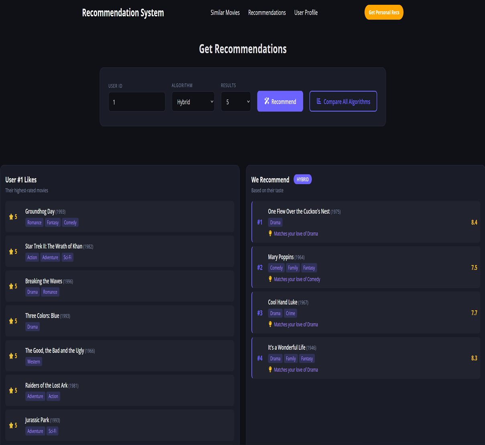
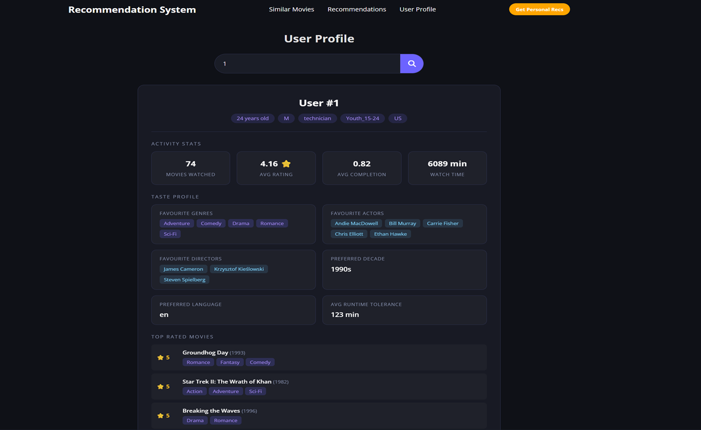
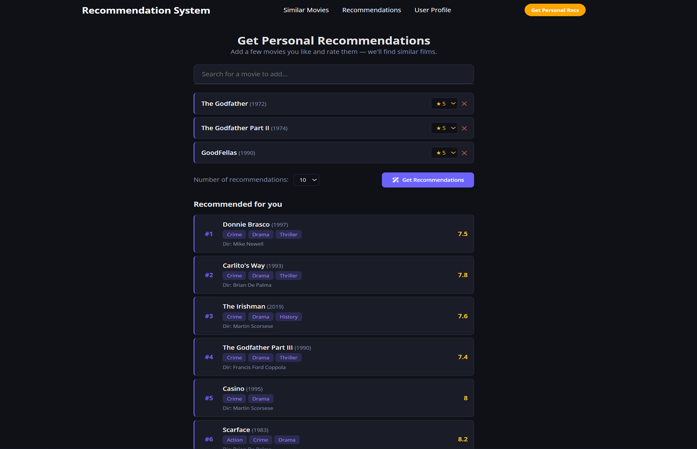
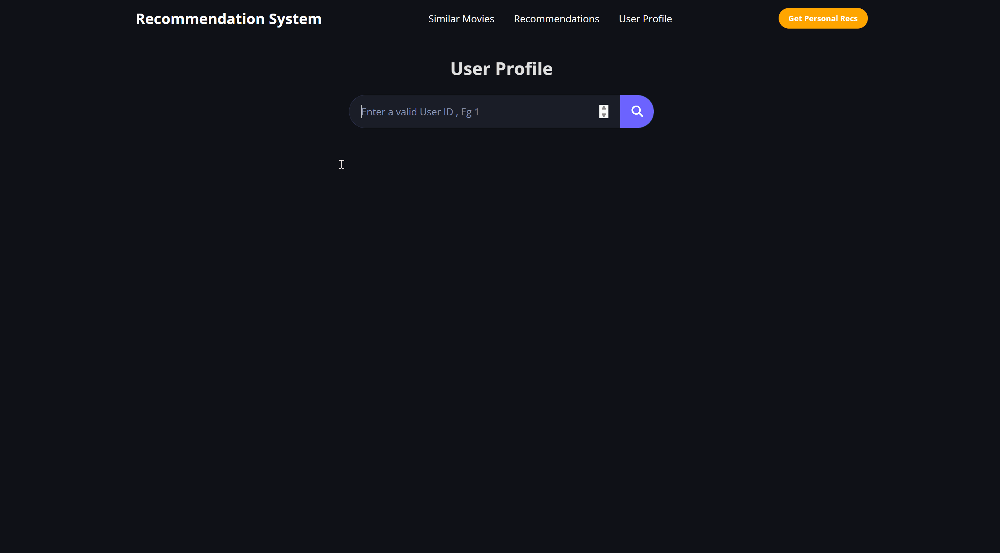

# Universal Recommendation System

A domain-agnostic recommendation engine that recommends **movies** or **news articles** through a single architecture — combining six recommendation algorithms (including a neural model), a transparent constraint layer, and a cold-start study on real data.

Built as a BSC project laboratory at the Budapest University of Technology and Economics (BME).

---

## Overview

Most recommender tutorials stop at one algorithm on one dataset. This project asks a harder question: **can one system serve different content domains, and which algorithm actually wins for which kind of user?**

It ships with:

- **Six recommendation algorithms** spanning three families — memory-based, model-based, and neural.
- A **constraint layer** that filters unsafe content and re-ranks by personal taste on top of *any* algorithm.
- A **cold-start study** on the Microsoft MIND news dataset, showing how a system should transition from generic to personalized recommendations as a user interacts.
- A **Django web app** with per-user recommendations, side-by-side taste comparison, "why this recommendation?" explanations, similar-movie lookup, and a personal cold-start page.
- An **evaluation pipeline** comparing classical matrix factorization (SVD) against a neural model (NeuMF) with proper offline protocols.

---

## Screenshots


| Recommendations + taste comparison | "Why this recommendation?" explainability |
| :---: | :---: |




| Personal cold-start page | User taste profile |






---

## The Algorithms

| Algorithm | Family | What it does |
| :--- | :--- | :--- |
| **Content-Based** | Memory | Dual-matrix similarity: CountVectorizer on metadata (cast, genres, keywords) blended 75/25 with TF-IDF on plot text. |
| **Collaborative** | Memory | Mean-centered user cosine similarity, so generous and harsh raters with the same taste still match. |
| **SVD** | Model | Matrix factorization (Surprise) — compresses users and movies into latent taste vectors. |
| **Hybrid** | Model | Weighted blend of SVD (40%) and collaborative (60%). |
| **Popularity** | Baseline | Global ranking — the cold-start fallback. |
| **NCF (NeuMF)** | Neural | Neural matrix factorization fusing a linear (GMF) and a non-linear (MLP) branch to learn complex user–item interactions. |

### Key finding: no single algorithm always wins

Testing the same users across all algorithms revealed a clear pattern:

- **Content-based** wins for users with **few ratings or focused taste** — it works from seed items alone.
- **SVD** wins for **dense users with eclectic taste** — it needs many ratings to learn an accurate latent profile.
- **NCF** has the **best aggregate ranking metrics**, but leans on popular films per-user — exposing the gap between offline metrics and real per-user relevance.

This gap is exactly why a multi-algorithm system is justified.

---

## The Constraint Layer

A re-ranking layer that sits on top of any algorithm's output:

**Hard constraints** (remove items entirely)
- Age gate — blocks adult genres for under-13 users
- Child-unsafe keyword filtering (e.g. *Indiana Jones* blocked by the keyword "nazi" for an age-7 user)
- Genre-overlap requirement with the user's taste
- Runtime ceiling (1.5× the user's average tolerance)

**Soft constraints** (re-weight and re-rank)
- Favourite director ×1.3, favourite actor ×1.15
- Preferred decade ×1.2 / distant decade ×0.9
- Liked genre +10% each, non-preferred language ×0.8

Measured effect: films by a user's liked directors scored 1.40 vs 1.13 on average — a 24% boost.

---

## Cold-Start Study (Microsoft MIND)

Using real news data, the system adapts its strategy to how much a user has interacted:

| Stage | Interactions | Algorithm | Why |
| :--- | :--- | :--- | :--- |
| **COLD** | 0–2 clicks | Popularity-based | No personal signal — the crowd is the best guess |
| **WARM** | 3–9 clicks | Content-based TF-IDF | Enough to detect topic interest, not enough for collaborative |
| **HOT** | 10+ clicks | Collaborative filtering | Enough behaviour to find reliable taste-neighbours |

**Research insight:** mean-centering is designed for explicit 1–5 ratings. For binary click data (0/1), every centered score collapses to 0, so raw cosine similarity on the click matrix is the correct choice.

---

## Evaluation

Each model is evaluated with the protocol that matches what it actually predicts:

| Algorithm | NDCG@10 | Precision@10 | Recall@10 | RMSE | MAP | Split |
| :--- | :---: | :---: | :---: | :---: | :---: | :--- |
| SVD (rating prediction) | 0.742 | 0.621 | 0.457 | 0.770 | — | Temporal (train pre-2017, test 2017–2019) |
| NCF (ranking)           | 0.756 | 0.732 | 0.145 | —     | 0.120 | Random 75/25 hold-out |

SVD uses a **temporal split** (train on the past, predict the future) because it predicts explicit ratings. NCF uses a **random hold-out** because it ranks items by interaction probability. RMSE applies only to rating prediction; MAP only to ranking — the dashes are intentional.

---

## Dataset

The system is built on real data — no synthetic ratings.

- **Movies:** MovieLens 25M ratings joined with TMDB metadata via fuzzy title matching + year validation.
  - 2.5M ratings · 10,606 users · 1,957 movies · mean rating 3.78
- **News:** Microsoft MIND-small (real news articles + real user click behaviour) for the cold-start study.

> Data files are **not** included in this repo (MovieLens 25M is ~700MB). The preparation scripts regenerate everything from the public source datasets — see Setup below.

---

## Tech Stack

**Python** · pandas · scikit-learn · Surprise (SVD) · TensorFlow/Keras (NCF) · **Django** (web app) · TMDB API

---

## Setup

**1. Clone and install dependencies**
```bash
git clone https://github.com/yahyaakh/universal-recommendation-system.git
cd universal-recommendation-system
pip install -r requirements.txt
```

**2. Add your TMDB API key**
```bash
cp .env.example .env
# edit .env and paste your free key from https://www.themoviedb.org/settings/api
```

**3. Build the movie dataset**

Download MovieLens 25M from [grouplens.org](https://grouplens.org/datasets/movielens/25m/), unzip into `data/ml-25m/`, then run:
```bash
python prepare_movielens25m.py
```

**4. (Optional) Build the cold-start dataset**

Download [MIND-small](https://msnews.github.io/) and run:
```bash
python prepare_mind_data.py
```

---

## Running

**Command-line engine**
```bash
python recomm.py
```

**Cold-start demo**
```bash
python cold_start_demo.py
```

**Train / evaluate the neural model**
```bash
python NCF_test.py
```

**Web app**
```bash
cd web
python manage.py runserver
# open http://127.0.0.1:8000
```

---

## Project Structure

```
.
├── recomm.py                  # Core engine: all six algorithms + constraint layer
├── cold_start_handler.py      # 3-stage cold-start logic (COLD / WARM / HOT)
├── cold_start_demo.py         # Cold-start demonstration on MIND data
├── NCF_test.py                # Neural model (NeuMF) training & evaluation
├── prepare_movielens25m.py    # MovieLens 25M + TMDB data pipeline
├── prepare_mind_data.py       # Microsoft MIND data pipeline
├── requirements.txt
├── .env.example
└── web/                       # Django web application
    ├── manage.py
    └── recommender/           # Views, templates, static assets
```

---

## Author

**Yahya Akhrikhar** — BSc Computer Engineering, BME
Supervisors: Dr Dávid Sik · Dr Mohammad Saleem

[LinkedIn](https://linkedin.com/in/yahya-akhrikhar) · [GitHub](https://github.com/yahyaakh)